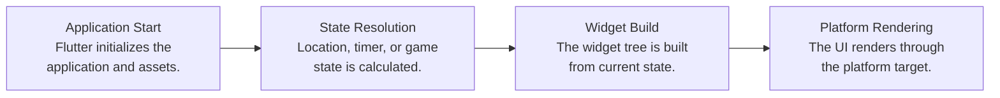

# ninja run flutter demo

A cross-platform Flutter runner-style game demo with platform-specific project targets and assets.

## Overview

The repository contains an implemented application or analysis project with code organized around its primary runtime, interface, data, or automation responsibilities.

## Key Features

- Cross-platform Flutter interface
- Widget composition and state management
- Asset and platform configuration
- Platform-specific build targets

## Technology Stack

| Area | Technology |
|---|---|
| Platform | Dart |
| Platform | Flutter |
| Library / Framework / Tool | HTML |

## Architecture and Data Flow

| Stage | Responsibility |
|---|---|
| **Application Start** | Flutter initializes the application and assets. |
| **State Resolution** | Location, timer, or game state is calculated. |
| **Widget Build** | The widget tree is built from current state. |
| **Platform Rendering** | The UI renders through the platform target. |

## Repository Structure

- `.gitignore`
- `.metadata`
- `analysis_options.yaml`
- `android`
- `assets`
- `ios`
- `lib`
- `linux`
- `macos`
- `pubspec.lock`
- `pubspec.yaml`
- `web`
- `windows`

## Setup

1. Install the Flutter SDK and required platform tooling.
2. Run `flutter pub get`.
3. Start the application with `flutter run`.

## Usage

Open the application entry point in the browser or run it with the project platform tools. Interact through the available controls and observe the rendered state.

## Configuration

No mandatory repository-specific configuration is documented by the project structure. Environment or runtime options may be defined inside the relevant entry-point file or platform settings.

## Verification

- Run the project entry point and verify the primary success and error paths.
