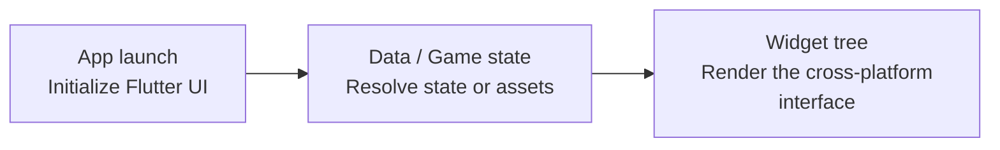

# ninja run flutter demo

**Portfolio project** · A Flutter cross-platform demo game with assets and platform targets.

## Overview

A Flutter cross-platform demo game with assets and platform targets.

## Technology Stack

- `Dart`
- `Flutter`
- `Cross-platform UI`
- `HTML`

## How the Repository Works

| Stage | Responsibility |
|---|---|
| **App launch** | Initialize Flutter UI |
| **Data / Game state** | Resolve state or assets |
| **Widget tree** | Render the cross-platform interface |

## Concepts Covered

- Cross-platform widgets
- State and navigation
- Assets and configuration
- Responsive layout
- Platform integration

## Repository Map

- `.gitignore`
- `.metadata`
- `analysis_options.yaml`
- `android`
- `assets`
- `ios`
- `lib`
- `linux`
- `macos`
- `pubspec.lock`
- `pubspec.yaml`
- `web`

## Recruiter Summary

This repository demonstrates practical implementation skills, repository organization, and an end-to-end understanding of the project workflow. It is suitable as a focused example of applied software or data work.

---

Documentation is concise and project-focused; source code was not modified.
